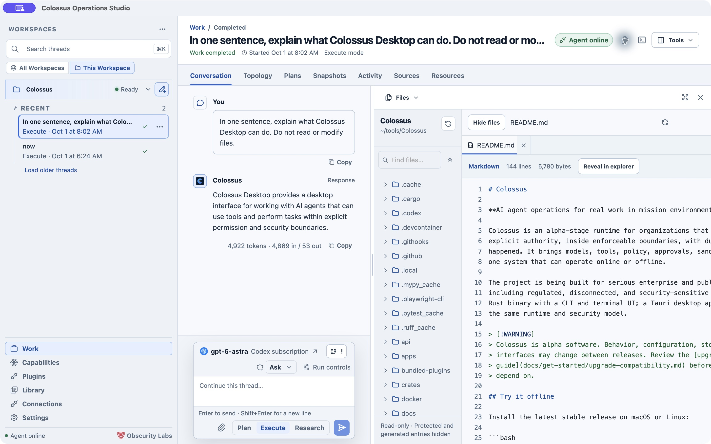

# Tools beside your work

Select **Tools** above a conversation to open a pane on the right. The tool switcher changes the pane without leaving your thread. Files and Terminal also have quick buttons in the Work header when available. Close the pane to give the conversation more room; opening it again restores its current context. Available tools depend on the platform, selected runtime, and workspace capabilities.

## Files

**Files** is a read-only browser for the selected workspace. Expand folders or search by filename and path, then open a file for syntax-highlighted preview. Open multiple files in tabs. When a run releases a file reference or diff, Desktop can open it in this pane. Protected and generated entries are hidden by the file browser; the pane itself does not edit files.

## Changes

**Changes** shows the current Git branch, changed-file count, and staged, unstaged, untracked, or conflicted files. **History** lists recent commits and affected files. Choose **Refresh Git** if you need a fresh view. This is inspection: Desktop does not stage, commit, switch branches, or contact remotes from this pane.

Under **Settings → Global → Git**, choose the opening view and whether Desktop refreshes Git on focus and periodically. You can still refresh manually when automatic refresh is off.

For a linked worktree or a folder inside a larger repository, **Connect Git** asks for native confirmation before reading repository metadata outside the selected folder. Git inspection is local to a Managed Local workspace; External targets do not expose it through the local reader.

## Active shells

**Active shells** lists managed commands and background servers started through the runtime. They can continue across model turns until stopped or until their deadline. Select one to inspect its bounded output; use **Stop** to request termination. This is different from the interactive local Terminal below.

## Terminal

Local terminals are selected by default for new workspaces. The first time you open Terminal, Desktop asks for native confirmation before enabling access; declining leaves terminal access off. Existing workspaces keep their saved choice. **Open Colossus TUI** attaches the bundled CLI to the *existing* managed worker. **Open Shell** opens a regular system shell in the selected workspace. The tab bar can add another TUI or shell session; closing a terminal tab ends that session. Switching workspaces closes terminal sessions belonging to the old workspace.

The TUI uses normal Colossus policy and audit. The shell is a local-user convenience outside agent policy, approvals, and the agent journal; commands you type there have your operating-system authority. A TUI needs Managed Local to be ready, while the shell can remain useful if the runtime is unavailable. External targets do not offer the bundled TUI. See [Terminal UI](../use/terminal-ui.md) for its commands and keys.

Under **Settings → Global → Terminal**, choose whether opening the Terminal tool selects a session automatically or starts a system shell. Automatic opens the TUI when Managed Local is ready and a shell otherwise. The explicit **Open Shell** and **Open Colossus TUI** actions keep their own behavior.

## Browser

**Browser** opens websites and local previews beside your conversation. Browsing is
temporary by default and separate from your usual browser. Availability depends on
the platform and release. Downloads, file uploads and device permissions remain
unavailable; use **Open in system browser** for flows that need them.

Under **Settings → Global → Browser**, set an optional HTTP or HTTPS new-tab address.
The default is an empty tab. Tabs are not restored when Desktop restarts.

### Remember a website sign-in on Windows

Open **Workspace browser profile** on that settings page and enable **Remember
sign-ins**, then save. This explicitly selects Windows WebView2 for human browsing
in the selected workspace. Its site data and unexpired persistent cookies survive
normal app restarts; websites still control sign-in expiry and session cookies.
Each workspace has a separate private profile. Agent Chromium sessions remain
temporary and do not receive this profile or its cookies; saved human tabs cannot
be handed to an agent.

**User-Agent** accepts a custom native browser value of up to 512 printable ASCII
characters. Leave it blank for the engine default. Setting a custom value also
selects WebView2; sign-ins remain temporary unless **Remember sign-ins** is enabled.
Saving these settings closes this workspace's human browser tabs. Password saving
and autofill remain disabled. Windows protects saved cookie encryption keys; other
site data stays inside the private app profile.

**Close all tabs** closes the current tabs. To remove saved sign-ins, choose
**Clear browsing data…** in Browser settings and confirm. It removes that
workspace's browser cookies, site data, cache, history and permissions.
**Reset browser profile…** also returns Remember sign-ins and User-Agent to their
defaults. These actions do not clear another workspace's profile.

### Diagnose sign-in failures

Open **Connection details** in the Browser footer. It shows the current origin,
engine, temporary or saved profile, default or custom User-Agent, and observed
certificate information. WebView2 also reports the main-page HTTP status, redirect
count and native navigation error. Other engines explicitly identify fields they
do not report. The panel excludes URL paths, query values, cookies, authorization
headers and private keys.

HTTP 401 or 403 means the server denied access. Check the intended account and
client identity, saved-sign-in setting, redirect destination and the website's
embedded-browser policy. A User-Agent override does not guarantee access. TLS
certificate verification stays enabled and cannot be bypassed. Opening the system
browser uses its own sign-ins; Colossus does not transfer cookies to it.

The default Windows Chromium browser automatically uses a single eligible matching
client identity. If several match, choose one in the certificate panel or cancel.
The optional human WebView2 mode uses the native Windows certificate chooser when
the site requests a client identity. Both use Windows certificate storage, which is
shared across applications rather than isolated by a browser profile. The PEM
identity in Desktop's network settings configures provider and HTTP calls
separately. The website decides whether the selected identity can sign in.

## Computer use

On Windows, **Settings → Global → Computer use** controls the default and
**Settings → Workspace → Computer use** provides overrides. It starts off.
Enable it and apply the workspace update to make permitted computer tools and
the `@computer-use` skill available.

Ask the agent to work with an open app. It selects a window, reads its accessible
controls or screenshot, and verifies each mouse or keyboard action. Screenshots
appear inline in the conversation and can be opened at full size. These actions
can affect apps and data outside your workspace.

A visible native card lets you pause or stop control. Moving the mouse or typing
pauses automation; use the card to resume. Protected input and Windows elevation
remain yours to handle. When the task ends, Colossus releases automation and leaves
the app open for inspection.

Windows may require you to bring the selected app forward before input can begin.
Colossus respects this foreground restriction and asks for help when focus is refused.

## Artifacts

**Artifacts** previews files released by the current thread. Switch between artifact tabs to inspect output without leaving Work. **Library** in the left navigation shows metadata for released artifacts across the current Desktop session. A file appears only after the runtime has released it; an unreleased tool result does not automatically become a Desktop artifact.

## Thread details and Aside

**Thread details** gives you the run status, participants, duration, workspace, and links to its plans, sources, snapshots, and other resources. **Aside** opens a separate conversation from the main thread's messages up to that moment. Use it to explore a question without changing the main thread. Aside replies stay separate; past Asides can be reopened from the pane.

## Next step

Read [Session views](session-views.md) for durable plans and source records, or [Settings](settings.md) to enable and configure available tools.
