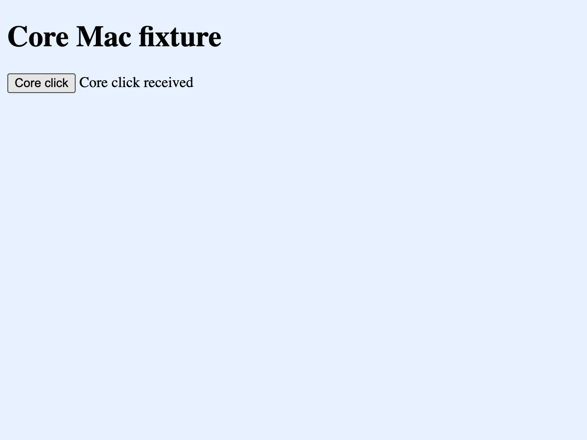

# ADR 0008: Owned Chromium browser

- Status: shared control and native Desktop composition implemented; functional and release gaps remain
- Date: 2026-10-11
- Related decision: [Desktop browser boundary](0003-desktop-browser-boundary.md)

## Context

Colossus needs browser automation in Core and unattended deployments, with strong
Desktop support. Platform WebViews provide useful human browsing but do not provide
one portable automation engine. Desktop must let the user see the page the agent
controls. A browser extension remains a separate future attachment adapter.

Browser pages are untrusted documents. A renderer, page, model tool argument, or
possession of a session identifier cannot grant browser authority. Certificate trust
and client identities also need native provisioning: the runtime HTTP client's TLS
configuration does not configure Chromium.

## Decision

Use shared typed contracts and an application-owned `BrowserDriver` port.
`colossus-browser` owns sessions, single-writer leases, control generations, document
and snapshot references, limits, and cancellation. `colossus-runtime` derives the
application, workspace, scope, and run identity from authenticated runtime state.
Its browser adapter consumes the exact effect permit before calling the coordinator.
Browser observations require post-effect release under both built-in and external
policy. Tool availability is a separate fact from action permission.

Implement native Chromium presentation through a pinned CEF component behind
`colossus-native-browser`, preserving the Tauri shell. The native host uses private
in-process DevTools methods. Its private action contract exposes bounded typed page
inspection when the host advertises it; web IPC receives no debugging endpoint or
general command transport. The component's archive checksums,
file inventory, licensing notices, sandbox startup, and platform bootstrap are part
of its distribution contract.

Desktop's browser host and Core's sidecar require a private authenticated native
bridge before shared-page automation can be enabled. The bridge must bind one host
enrollment to the supervised runtime, workspace, application, and exact owned native
session. A renderer cannot supply an executable, native parent handle, personal
profile, transport endpoint, or execution authority.

The managed sidecar now composes that private attachment through a separate native
credential, enrolled parent/child process identities, and the exact workspace and
application. Ordinary worker authentication cannot allocate a native human page.
The native session owns a canonical conversation; the Desktop pane can hand its
page to a run only in that conversation. It revokes human input before awaiting
the handoff and becomes read-only while the agent owns the page. A cancelled or
uncertain handoff leaves input revoked and pixels hidden. This source composition
does not advertise embedded availability without an accepted platform supervisor.

`colossus-browser-bridge` implements separate authenticated action and cancellation
channels, validates readiness on both channels, and owns a bounded per-session host
pool. The supervisor retains each allocation before attempting process startup.
Unknown allocation and teardown results remain owned obligations. Native CEF
terminal cancellation and run completion close the owned context. The coordinator
requires a new session instead of issuing a writer lease for a destroyed page.

Availability remains false until the installed engine can enforce the complete
network envelope. CEF navigation and resource callbacks alone do not contain
WebSocket, WebRTC, service-worker, and background traffic. A working native display
or a successful DevTools command is insufficient evidence for production automation.
Embedded and headless placement are accepted independently. Missing components and
unsupported bootstrap fail explicitly; there is no personal-browser fallback.

Run production agent browsing in a separately supervised browser host with one
immutable effective network envelope. The host's browser, network service, renderer,
worker, and helper processes must all inherit the operating-system restriction;
sandboxing renderers alone leaves the browser and network service able to bypass it.
The current in-process Desktop preview shares Desktop's network authority and cannot
establish this boundary. A private authenticated connection by itself does not change
that fact.

Core dispatch and native presentation are separate connections to the same owned
host. Native parent handles are process-local presentation data and never runtime or
renderer authority. In particular, a macOS `NSView` cannot be transferred to another
process to reuse the current child-view adapter. A production presentation adapter
must establish a bounded native frame or texture relay and native input ownership,
with independent compositor, keyboard, IME, focus, overlay, and accessibility
acceptance. `colossus-browser-presentation` authenticates bounded frames and binds
input to the admitted session, tab, document, control generation, and viewport
epoch. Native HWND and NSView consumers own their pixel copies and expire visible
surfaces independently of the frame stream. Connected Desktop/SDK/worker composition
is implemented in source; native platform acceptance remains required before it
replaces the preview.

Transferring a human page requires an authenticated native input-fence receipt.
The native host stops human input before reporting its current document. Core then
compares the original session, selected tab, document and control generation,
adopts that exact native document, and grants one writer in a single state change.
It clears prior references and requires a fresh snapshot. Ordinary writer grants
cannot attach to a fresh human allocation. A lost or rejected fence receipt keeps
the native page fenced and retains its cleanup owner.

Network revocation must stop accepting connections and acknowledge closure of every
active connection before reporting quiescence. An authenticated HTTP proxy is only
one part of the boundary. CONNECT destination and TLS SNI checks do not inspect
encrypted HTTP authority or prevent HTTP/2 origin coalescing. The installed host
must prove request-origin enforcement as well as direct TCP, UDP, QUIC, WebRTC,
loopback, and DNS bypass denial before advertising browser availability.

PKI provisioning and selection remain native operations. Private CA trust and client
identity import must disclose the actual OS-user or NSS-store scope. A temporary
browser profile does not imply isolated certificate custody. Identity selection
requires an exact HTTPS origin and reviewed certificate fingerprint; private keys
and import passwords never become model arguments or ordinary renderer values.
Normal server verification remains enabled.

The Linux developer host provisions a fresh owner-private NSS home and uses pinned
NSS tools. CA trust is explicit; importing a PFX never implicitly trusts its CA
chain. Client selection checks the current exact HTTPS origin, eligible native
certificate DER, validity, and reviewed leaf fingerprint. The maintained native
TLS fixture covers successful private CA and client-key use, invalid certificates,
unapproved redirects, and cleanup. The actual Core per-request registry fixture
also passed seven exact owner enrollments, six allocated-host graceful shutdowns,
server-observed identity/CA/redirect cases and mixed-origin consent rejection
before allocation, with all owned state removed. A separate corrected
renderer-custody experiment completed mTLS, page loading and shutdown. Its latest
bounded live-receipt attempt reached a native challenge, but reported `rejected`
with `process_not_found`: the parent could not authenticate a matching live
renderer. No valid direct-key-denial receipt was accepted. Linux renderer and
broker key custody therefore remain unaccepted. These TLS results also do not
establish macOS or Windows certificate-store custody,
signed installation, or whole-host containment.

CLI and the managed sidecar share fixed installed-package verification. Each
executable embeds its own publisher-verified manifest at build time; ordinary
discovery verifies the adjacent payload again before injecting a browser driver
into its runtime. The worker retains a separate supervisor and awaits shutdown
on setup, serving and error exits. Current package discovery supports Linux
headless placement only. The Windows supervisor and Desktop presentation adapters
remain development components; macOS still lacks an accepted separate-host
containment owner. These paths do not enable production Desktop attachment. No
publisher-accepted browser payload currently ships, so ordinary CLI and worker
discovery remain unavailable instead of choosing an ambient browser or downloading
one.

Windows also has an explicit, compiler-selected `windows-browser-development`
Debug composition for functional automation under an ordinary user token. It
keeps Chromium's built-in sandbox, the owned Job and authenticated action,
cancellation and presentation channels. It reports `restrictive_egress: false`;
AppContainer/WFP containment and owned certificate custody are deferred in this
composition. There is no automatic fallback from a failed contained launch.
The standard installer and normal browser use must not require administrator
access. A future privileged containment edition must be selected separately.

This Windows development composition advertises richer guest pointer actions,
native presentation annotations and bounded developer inspection as distinct tools.
Element and coordinate input retain current snapshot and document fences; coordinate
input also requires the exact physical screenshot dimensions. Annotations do not
modify the DOM or dispatch input. Clean and annotated screenshots use the existing
private transfer, output policy and owner-bound artifact publication. Developer
inspection uses native side-effect-checked JavaScript evaluation or a closed list of
page-scoped CDP methods, and its bounded results require post-effect release. The
native host's advertised actions and the authenticated application grant both constrain
the offered tool catalog. Inspection rejects protected-field and child-document
pages; the [security architecture](../security-architecture.md) describes its private
pause, guard and acknowledged restoration boundary. Reproduce the source tier with the
[Windows interaction acceptance](../testing.md#windows-rich-interactions-and-annotations).

The development sidecar injects the actual Windows supervisor into Runtime and
Desktop attaches that same Core-owned page through its native pixel presenter.
Run lifecycle registration now receives the qualified tool catalog after turn
preparation, so native handoff checks the current offered tools without changing
the registered run's identity or bypassing effect policy. The reproducible
[Windows automation acceptance](../testing.md#non-admin-owned-windows-browser-automation)
uses the existing SDK/sidecar/worker channels. This exception does not enable
publisher release modes, private CA/client identity capabilities or installed
signed-package acceptance.

Temporary profiles remain the default. The Linux native store implements explicit
opaque workspace/application profiles, one retained kernel writer lease, exact
CEF/Chromium/protocol compatibility, durable active/dirty state, and reset after
acknowledged process cleanup. CEF uses a fixed per-request-context cache beneath
the retained root cache path. Runtime filesystem and process adapters protect the
same native store independently of model grants, including inode aliases.
Unknown cleanup or an interrupted reset fences reuse and cannot authorize clearing
the cache. Five actual sequential native hosts demonstrated server-observed cookie
survival across a fresh-host restart, absence after reset and between temporary
contexts, concurrent reuse rejection and graceful cleanup of every host.
This private cache is unencrypted and its persistent bind mount has no
disk quota. Ordinary OCI installation rejects this option; it is diagnostic-only
until storage protection and resource bounds are accepted. Native SDK profile
management and a Desktop profile selector are not yet implemented.

## Current enablement and remaining work

Completed source and native fixture evidence have separate scopes. A standalone
CEF host result does not prove Core's supervised OCI launch, signed installation,
or whole-host network and certificate custody. The curated OCI seccomp policy
omitted the read-only `sysinfo` call used during Chromium's pre-sandbox memory
query. A restricted startup diagnostic with the identical component completed
CEF initialization after allowing only that additional call. The source policy
includes the correction. The actual three-channel Core-to-OCI fixture then passed:
policy denied an unreviewed origin before allocation, a real page snapshot exposed
its ordinary accessibility label and redacted its protected value, and run finish
acknowledged graceful CEF shutdown and complete physical state cleanup. The
four-channel Core fixture passed authenticated 801×601 BGRA page frames, rejection
of human input/focus and invented human generation, and independent viewer detach
without losing the agent page. The five-host profile and per-request PKI fixtures
also passed with graceful physical cleanup. Each fixture checked the unchanged
component. These are actual Core conformance results, not production containment
or signed-distribution acceptance.

The macOS Debug Core fixture now launches the independently staged and signed
CEF host through the authenticated bridge. Its actual page accessibility tree,
button click, navigation and decoded 1280×960 screenshot passed. The native
presentation channel also passed fractional-scale rounding, resizing at 2×
Retina scale and independent viewer detachment. CEF acknowledged closing and
the direct host exited zero. This uses one fresh temporary profile, a synthetic
Safe Storage provider and one numeric plain-HTTP loopback origin. It does not
accept persistent profiles, certificate custody, complete helper cleanup or
parent-crash recovery. Managed Core-to-Desktop foreground acceptance remains
separate. Reproduce the fixture with the [native component instructions](https://github.com/obscuritylabs/Colossus/blob/main/native/browser/README.md#run-the-debug-core-mac-http-diagnostic).

The managed Desktop diagnostic has also submitted actual authenticated human
page pixels to its native NSView at 2× Retina scale, hidden and cleared the view
for an overlay, restored it, transferred the page to an authenticated Core run,
and observed Core snapshots, a click, navigation and published PNG metadata.
The connected HTTP diagnostic passed recovery of a fresh native frame after
screenshot capture, a bounded visible-page interval, viewer detachment, Core run
completion, browser close and verified sidecar shutdown. CEF acknowledged closing
and the direct host exited zero. OS window inspection captured the green
agent-controlled page during a complete passing 40-second visual run, and a
separate capture showed the human fixture. These results retain the temporary HTTP diagnostic scope;
they do not establish whole-helper cleanup, native keyboard/IME acceptance, HTTPS
custody or signed installed automation.

The full pinned CEF build now passes the private-export and completed native-image
checks. Actual owned Core HTTPS launches reach `CefInitialize`, but page opening
still fails: Apple's framework URL uses the `/tmp` alias, and the delegated
launcher rejects CEF's unreviewed descriptor/process-requirement combinations.
The private diagnostic retains those failures and the known-roster cleanup facts;
it does not report a real-helper or page-rendering pass. A separate Desktop run
confirmed that the repaired bounded input queue survives native typing bursts,
but Unicode and Mac shortcut acceptance still failed. Neither result enables
production automation.

The Mac development process owner now composes independent creator and keeper
processes with signed fixed front/body images. Five actual signed, sandboxed
fronts passed the pre-body custody diagnostic: main, renderer, GPU, network and
utility roles denied the tested custody file operations, extension issuance and
use, and SecurityServer/securityd/trustd routes before loading any body. Each
front exited zero and was reaped by its actual parent. This standalone diagnostic
loads no CEF or Keychain. The signed no-CEF supervisor fixture also passed
cancellation, Core-channel EOF, abrupt Core exit without destructors, and abrupt
Core exit with lost diagnostic readers. The creator reaped Main and four fixed
helpers; an independent observer confirmed creator and keeper exit after Core
crashed. This accepts the tested known roster, not the unresolved creator
spawn-to-enrollment crash window or a complete Chromium process domain.

The independent signed TLS broker passed four native cases: authenticated HTTPS
and graceful direct-child shutdown, owner EOF, rejection of the wrong signed
parent, and observed broker exit after an admitted parent crash. The live HTTPS
cases verified the normal certificate chain and hostname, exact downstream leaf
pin and upstream request without proxy credentials. Both listeners and a held
partial socket closed. These results cover the broker's tested process and
sockets. A separate signed native custody fixture subsequently passed
server-observed mTLS with its reviewed client identity, normal TLS validation,
tracked socket drainage, durable exact-generation Keychain removal and a
nonforced zero-exit reap. Default and search-list metadata remained unchanged.
That fixture loads no CEF; Core certificate enrollment, Core/CEF HTTPS composition
and custody crash recovery remain unaccepted. Reproduction and evidence scope are documented in the
[TLS broker instructions](https://github.com/obscuritylabs/Colossus/blob/main/native/browser/tls-broker/README.md#signed-two-process-acceptance-fixture).

| Area | Implemented or demonstrated | Remaining requirement |
| --- | --- | --- |
| Shared authority and artifacts | Typed tools, one writer, stale-reference fencing, authenticated private channels, retained cleanup, screenshot/upload/download gateway release | Native action and cleanup acceptance must match the exact installed component and image |
| macOS human preview | Native rendering, AppKit coexistence and preview lifecycle acceptance. Separate Debug host staging signs a fixed main entry and five paired helper entries; bounded native Seatbelt checks deny unselected loopback ports for the main/network helper and all tested helper traffic for renderer, proxy-resolver and print roles | Implement the independent separate-host process owner, complete request-origin enforcement and owned certificate custody, then accept Core/Desktop native composition; preview or policy-fixture success does not enable automation |
| macOS Core diagnostic | Signed separate-host launch, authenticated page control, decoded screenshots, native Retina frames, overlays, human-to-agent handoff, viewer detachment and verified Core/Desktop direct-host shutdown passed for a temporary HTTP loopback fixture | Independent complete helper cleanup and parent-crash recovery, authenticated HTTPS origin/TLS broker, owned certificate custody, native keyboard/IME and installed-package acceptance. Production discovery remains disabled |
| Native Desktop attachment | Managed SDK/sidecar/worker admission, canonical conversation ownership, native human fence and atomic human-to-agent handoff, read-only native frames | Connected Windows/macOS OS acceptance; same-page agent-to-human takeover is absent. Terminal cancellation and run completion close the owned context; human access requires a fresh session |
| Linux contained host | Networkless OCI supervisor, authenticated egress relay, exact process identity and cleanup ownership; actual Core open/snapshot, read-only frames/detach, profile restart/reset and per-request PKI fixtures with graceful physical cleanup | Broker/socket denial, crash/reaping and installed-package acceptance |
| Windows contained host | AppContainer/Job/WFP supervisor, private I/O, pinned helper/client staging and native frame/input fixtures; source checks | Actual Windows SDK/OS execution, browser/network-service/helper denial, full-tree cleanup, native input and installed signing acceptance |
| PKI | Native exact-origin reviewed identity selection; Linux owned NSS provisioning and actual Core per-request fixtures. A signed Mac no-CEF fixture passed private Keychain import, server-observed native mTLS, socket drainage and durable exact-generation removal while default/search metadata stayed unchanged | Linux broker custody remains unaccepted. Mac Core enrollment, full-component key isolation and custody crash recovery require acceptance; Windows owned-store and broker acceptance remain incomplete. Existing OS-user stores are not isolated by a temporary browser profile |
| Persistent profiles | Linux native store, exclusive lease, compatibility/dirty/reset behavior and independent tool filesystem denial; actual five-host cookie restart/reset/temporary-isolation proof | Encryption and disk quota, native management and Desktop controls. Production configuration remains disabled |
| Human multi-origin login | Native human admission binds the initial URL's exact origin | Trusted review/admission of additional origins; cross-origin SSO redirects are currently denied in an owned human context |
| Shipping package | Shared verifier, compiler-bound publisher seal and offline Linux package builder | Independently reviewed signed component/image receipts and accepted distribution. Headless and Embedded modes stay disabled until their own acceptance passes |

These include implementation work as well as platform tests. Enabling an inventory
flag, running a preview, or passing a fixture cannot substitute for missing
capabilities or publisher acceptance. The platform WebView remains the shipping
human browsing surface, and a later extension adapter remains outside this change.

## Consequences

Core, workflows, CLI, and Desktop can share one tool and ownership contract without
linking runtime or policy implementation into Desktop. A later MCP facade or browser
extension can implement the same port without creating another policy path.

The implementation includes shared owned control and an explicit native preview boundary.
It does not change the shipping platform-WebView default until native platform
acceptance and the private bridge are complete. Engine replacement, native PKI,
unattended operation, and shared-page automation each require their own evidence.
Snapshots remain bounded text observations. Screenshots use a closed native capture
action and authenticated 64 KiB chunks; the complete bounded PNG enters the effect
gateway before an owner-bound RunOutput artifact and typed model image are published.
The next image-capable model turn receives a tool-provenance image, with the original
call association retained in the durable session. Text-only models receive the
artifact metadata; their canonical history retains the released image for later
image-capable continuation. Uploads and downloads use separate closed artifact
custody contracts rather than model-selected filesystem paths. Persistent profiles
require explicit opt-in, one native owner, compatible version metadata, and protected
storage. Native transfer, profile, and platform acceptance determine which of these
capabilities a particular installed host advertises.

See the [feature inventory](../feature-inventory.md) for implementation and evidence
owners. The existing [Desktop browser decision](0003-desktop-browser-boundary.md)
continues to describe the shipping human browsing surface.
