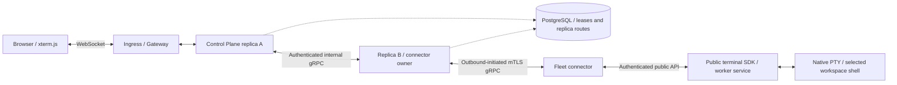

# ADR 0011: Human terminals through Fleet

- Status: Accepted
- Date: 2026-10-24

## Context

Desktop provides a human shell using xterm.js and native PTY supervision. Fleet users
also need a shell in the selected workspace from the web application. The existing
agent `shell.run` tool and TUI `!` commands execute individual policy-governed commands;
neither is a persistent interactive human terminal.

The Control Plane runs multiple replicas. A browser and an enrolled connector can land
on different replicas. Existing durable task and resource delivery does not provide an
appropriate transport for interactive terminal bytes. A terminal must retain its
native process when a browser, connector, or Control Plane connection is replaced.

## Decision

Use xterm.js for browser terminal emulation and WebSocket for browser input/output.
Retain native gRPC over mutually authenticated TLS for outbound Fleet connectivity.
A narrow, authenticated internal gRPC relay forwards terminal operations to the replica
owning the exact enrolled connection. Ordinary ingress load balancing remains valid;
neither client-IP nor cookie affinity is a correctness dependency.

The browser may connect to any replica. That replica resolves the fenced connector
owner and forwards through the internal relay when necessary. The connector calls only
the public SDK. The host worker owns the PTY independently of agent/provider runs.
PostgreSQL stores connection ownership, bounded authenticated capability advertisements
for each fenced connection, and bounded replica route metadata; terminal
input and output do not enter the task outbox, model context, or runtime journal.

### Authority

Remote terminals require three independent choices: native host enablement, an
application grant containing `terminals:control`, and the authenticated human's project
`terminal` permission. Existing roles, global administration, workspace visibility,
thread sharing, and enrollment do not silently confer this permission. The explicit
Terminal operator role adds it to ordinary operator permissions.

The Control Plane derives the human owner from authenticated project/account/node
identity. Renderers supply opaque session/controller IDs and bounded terminal input and
dimensions; they cannot nominate an executable, host path, environment, owner, or local
application credential. Personal-node visibility remains independently enforced.

The shell executes with the worker's OS user authority. An arbitrary interactive byte
stream cannot be reliably divided into commands for individual agent policy approval.
The human shell therefore has distinct authority from agent tool execution. Session
access/lifecycle evidence must not claim command-level effect auditing. Terminal bytes
and passwords are not recorded in telemetry or default transcripts. Native sanitization
prevents terminal output from acquiring clipboard, link-launch, or browser authority.

### Lifecycle and recovery

Open requests have stable caller-bound identities. A controller lease and monotonic
writer epoch fence stale tabs. Input sequences detect duplicate deliveries; uncertain
input is never automatically retyped. Read-only output replay cannot launch commands.
Native sessions, retained output, pending transport messages, dimensions, and lifetimes
are bounded. Separate terminal admission prevents a noisy stream from exhausting agent
approval, cancellation, or heartbeat capacity.

Transport loss detaches the subscriber rather than killing the shell. A bounded idle
lease allows reattachment while the worker survives. Explicit Close requests process
termination. Worker or machine restart ends the shell; the next worker incarnation must
not adopt an old PID or silently recreate it.

Output is sequenced together with resize events. A live browser reconnect continues
after its parsed output cursor. A fresh emulator must replay complete retained history
from the original dimensions, or report an explicit history gap. An arbitrary retained
suffix cannot reconstruct ANSI parser state or an alternate screen. Replay-generated
terminal responses must not be written back to the live shell. Seamless restoration
after retention eviction requires a separately validated emulator checkpoint contract.

### Deployment

Replica routes are operator-advertised internal endpoints with bounded expiry and
authenticated TLS. Relay admission verifies the exact current connector lease and
generation. A route read grants no ability to contact a browser-selected address.
Rolling replacement closes streams so clients resolve the new owner and reconnect;
the native shell remains on the Fleet machine. Ingress/controller acceptance must prove
WebSocket upgrades, streaming timeouts, and replacement across replicas.

## Alternatives

Connect and gRPC-Web provide useful generated browser APIs, but standard browser clients
provide unary and server streaming rather than a single bidirectional RPC. Combining
an output stream with unary input is viable but does not remove connector-owner routing
and adds independent request ordering. Existing Protobuf/gRPC contracts already provide
the typed native boundary; a protocol migration is not needed for this feature.

SSE plus POST has the same split-input behavior and text framing overhead for PTY bytes.
WebTransport offers bidirectional streams but needs additional ingress/controller
support. Neither alternative supplies PTY persistence, safe input replay, or screen
restoration. A connector-owned PTY would add process-execution authority to an adapter;
a separately supervised terminal daemon can be considered if worker-restart survival
becomes a requirement.

## Consequences

The native terminal core is independent from Tauri and usable by the worker. Desktop
retains its local-user terminal lifecycle and enablement; a local enablement is not a
remote grant. Linux Fleet requires its own tested PTY/session cleanup implementation.
The public terminal service and Fleet lane are capability-gated so older hosts continue
ordinary work without advertising shell availability.

This adds an internal replica relay and a privileged human access surface. Required
acceptance covers cross-replica routing, stale owners, forbidden users, expired grants,
disconnect/reconnect without input replay, output gaps, bounded slow consumers, native
process cleanup, and real browser keyboard/resize behavior. See [architecture](../architecture.md),
[public SDK boundaries](../application-sdk.md), [state recovery](../state-recovery.md),
and [Control Plane development](../cloud-control-plane.md) for the owning contracts.
