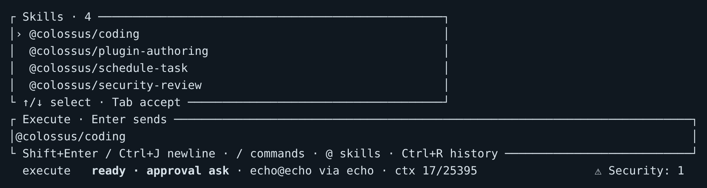

# Skills and plugins

A **skill** gives Colossus instructions for a particular kind of work. A **plugin**
packages skills and may also include resources or MCP server declarations. The CLI
includes the `colossus` plugin with `coding`, `plugin-authoring`, `schedule-task`, and
`security-review` skills. It also includes `documentation`, a curated adaptation of
the Google Developer Documentation Style Guide.

When a verified browser is enabled, the bundled plugin also provides
`colossus/browser`. In Desktop, type `@browser` and choose **Browser** to insert
`@colossus/browser`; the qualified mention works in other skill-aware composers.
The skill explains fresh snapshots, observed element references, temporary
sessions, file transfers, and recovery without repeating unknown external effects.
It disappears from the available skills when browser access is disabled or the
native browser is unavailable. Selecting a skill never enables a capability.
See [Browser settings](../reference/configuration/limits.md#browser-access-and-limits)
for configuration and app controls.

Use `coding` to implement features, fix bugs, debug failures, or refactor software. It
guides repository inspection, implementation, and verification. Follow your environment's
instructions for internal package registries, documentation locations, and network
constraints, including in air-gapped deployments. The former bundled `offline-dev`
skill has been removed; use `coding` with your environment's development guidance.

## Choose a skill for one message

Type `@` in the terminal composer to open the skill picker. Use **Up/Down** to choose
a qualified name and **Tab** to insert it. Then write your request and press
**Enter**:

```text
@colossus/coding Fix the error handling in this module and verify the failure paths.
```



The selected skill applies to this message. The picker shows skills from plugins
available in the current workspace; type a qualified `@PLUGIN/SKILL` name directly
if you already know it. [Open the full-size screenshot](../assets/screenshots/skill-picker.png).

## Keep a skill selected for the conversation

Use `/plugin skills` to see available qualified skills, then select one for later
messages in this conversation:

```text
/plugin skills
/plugin use colossus/coding
/plugin active
```

The sticky selection stays active until you remove it, clear all selections, or end
the conversation. You can still add a skill to a single message with `@`.

```text
/plugin remove colossus/coding
/plugin clear
```

If an existing conversation selected `colossus/offline-dev`, switch it to `coding`:

```text
/plugin remove colossus/offline-dev
/plugin use colossus/coding
```

Use `@colossus/schedule-task` to create or control recurring tasks through the scheduling tools. See [Workflows and schedules](../desktop/schedules.md#start-with-an-example-or-an-agent) for prompts and timing behavior.

Use `/plugin show colossus/coding` to read the skill instructions. A plugin can offer
several skills; selecting its name in plugin inventory does not select them all.

## Write developer documentation

When automatic documentation guidance is enabled (the default), Colossus instructs
agents to read `colossus/documentation` for documentation writing and editing tasks.
The short instruction applies to READMEs, API documentation, tutorials, and how-to
guides. The agent chooses relevant topic references through the read-only plugin
reader; the full guide is not added to every prompt. Unrelated tasks receive only
skill metadata and the conditional instruction, without the guide's reference text.

To choose the skill explicitly:

```text
@colossus/documentation Update the installation guide for the new release.
```

The bundled copy is managed with the executable and is available to workspaces using
its explicit Colossus home. It needs no separate download. Disable automatic use while
keeping explicit selection available with `plugins.documentation.autoActivate: false`.
Choose another accepted or installed qualified skill with `plugins.documentation.skill`.
See the [configuration reference](../reference/configuration/extensions.md#documentation-policy)
for fields and availability rules.

For a team-specific copy, put a skills-only plugin under
`.agents/plugins/team-writing/`, following [Agent Plugins](../extend/plugins.md).
Copy the documentation skill directory from the Colossus distribution or source,
including its `LICENSE.txt` and `references/` directory, into
`skills/documentation/`. Use a distinct plugin name such as `team-writing` in its
`plugin.json`; the bundled `colossus` name is reserved. Then accept the workspace source:

```bash
colossus plugins add .agents/plugins/team-writing
```

Set `plugins.documentation.skill: team-writing/documentation` for that workspace.
Acceptance is local to the workspace; it does not install a global package. For reuse
across workspaces, distribute this same skills-only plugin through the normal
[signed package workflow](../extend/plugins.md#add-a-signed-package). Installed packages
are shared within the selected Colossus home. An accepted local source with the same
plugin name takes precedence only in that workspace. Neither installation nor reading
these references enables execution, workspace writes, or network access.

User instructions and repository documentation requirements take precedence over the
style recommendations. The references are a condensed adaptation attributed to Google
and licensed under CC BY 4.0, with source links, change notices, and the license included.
They contain no upstream code samples. Maintainers review upstream changes deliberately;
there are no runtime downloads or automatic reference updates. See the skill's
`references/sources.md` for the reviewed sources, date, and maintenance procedure.
Update Colossus for bundled revisions, or use the normal plugin lifecycle for a separate
copy. Active runs keep their captured policy and reference snapshots.

## Review a repository's security

Select the security-review skill and specify the target or change and deployment
context that affects the threat model:

```text
@colossus/security-review Review this repository's authorization and plugin boundaries.
It runs as a local agent with untrusted tool servers. Use static analysis and report
verified findings, unresolved questions, and coverage.
```

The skill maps trust boundaries, traces attacker-controlled input to sensitive
operations, and verifies suspected findings against source. Large reviews use bounded
child jobs when delegation is available; the coordinator checks their evidence and
accounts for unfinished work. See [Goals and subagents](goals-subagents.md) for job
status, worker readiness, and recovery.

For reviews spanning several files or stages, the agent keeps sanitized working notes
and evidence under an already ignored `.local/security-reviews/` directory, or uses an
authorized temporary directory when checkout-local storage is unsuitable. These files
help resume work after compaction; they are not a sandbox or a substitute for rechecking
source. See [Context and snapshots](sessions-context.md) for budgets and snapshot behavior.

The report separates verified vulnerabilities from unresolved leads and states which
surfaces and tools were checked. Static analysis can establish a finding without an
exploit reproduction. Local validation uses isolated fixtures when authorized and
available. Request fixes explicitly when you want product changes as well as a review;
skill selection does not grant additional tool or filesystem permissions.

## Inspect plugins

Enter `/plugins` to see installed packages and workspace sources with their status. Use
`/plugins show colossus` for one plugin. A plugin must be enabled and available in
the workspace before its skills can be selected. Use `colossus plugins add` to accept
a local directory or verify, install, and activate a signed package in one flow.
See [Agent Plugins](../extend/plugins.md) for a working `.agents/plugins` example.

Skills guide the agent's behavior; they do not add tool permissions or bypass
approvals. An MCP server packaged with a plugin also needs its own explicit server
enablement and tool selection. See [MCP servers](mcp-servers.md) to inspect
configured servers.

## What's next?

<div class="grid cards" markdown>

-   :lucide-box:{ .lg .middle } **Agent Plugins**

    ---

    Author, install, verify, and enable a plugin with its own skills and resources.

    [Explore Agent Plugins :lucide-arrow-right:](../extend/plugins.md)

-   :lucide-network:{ .lg .middle } **MCP servers**

    ---

    See which external tool servers are configured and discover their tools.

    [Explore MCP servers :lucide-arrow-right:](mcp-servers.md)

</div>
